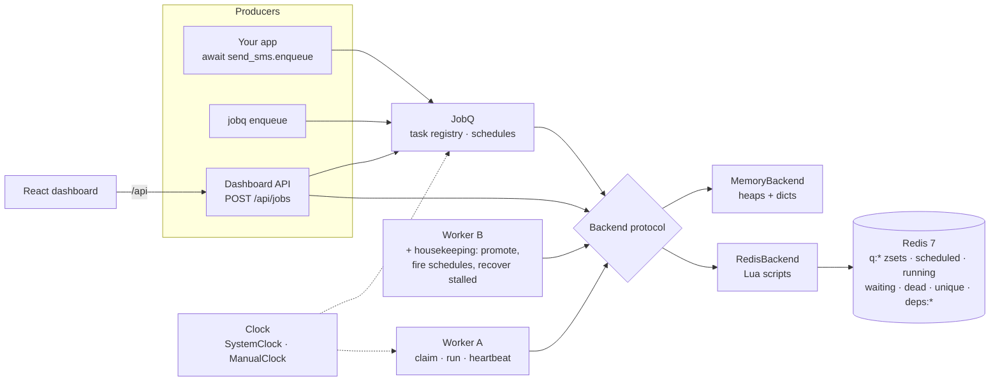

<!-- topics: background-jobs,task-queue,redis,lua,asyncio,cron,fastapi,react,typescript,python,dashboard,worker -->
# Background Jobs Queue

A Redis-backed background job system for Python services: priorities, delays, cron schedules, retries with jittered backoff, unique jobs, job dependencies, dead letters and stalled-job recovery, with an in-memory backend for tests, a Typer CLI, a FastAPI dashboard API and a React UI to operate it.

[](https://github.com/AkibUllah/background-jobs-queue/actions/workflows/ci.yml)


## Why this exists

Every payment or e-commerce backend I have worked on grows the same tail of work that must not run inside the request: OTP SMS, bKash reconciliation polls, webhook deliveries, nightly settlement reports, search re-indexing. The first version is a `BackgroundTasks` call; the second is Celery with RabbitMQ and a week of tuning for features nobody uses. This repo is the middle ground I keep wanting: one Redis, one small package, every state change done in a Lua script so two workers can never claim the same job, and a dashboard that answers "why did this job die and can I retry it" without opening `redis-cli`. The in-memory backend runs the identical state machine, so the whole system is testable in-process and the tests move time with a clock instead of sleeping.

## Features

- `@app.task` decorator for async or sync functions (sync tasks run in a thread pool); `await task.enqueue(...)` or `task.options(priority=5, delay=60).enqueue(...)`
- Priorities (higher first, FIFO within a priority), delays and absolute `run_at`, per-job timeouts, configurable retries with exponential backoff and jitter, `raise Retry(delay=...)` from inside a task
- Cron (`"30 2 * * *"`, aliases, names, timezone such as `Asia/Dhaka`) and interval (`every=30`) schedules, synced by workers, fired exactly once per due time even with many workers
- Unique jobs (`unique=True` or explicit `unique_key`) deduplicate while an earlier job is still pending, running or retrying
- Dependencies (`depends_on=[job.id]`): a job waits until its parents succeed; a failed parent cancels the whole chain with a reason
- Dead-letter set with retry / requeue / delete actions, result storage with TTL, per-minute throughput counters
- Heartbeats and stalled-job recovery: jobs whose worker disappeared are re-queued (or dead-lettered once retries are spent); graceful shutdown releases in-flight jobs to the front of their queue without counting an attempt
- Two backends behind one protocol: `RedisBackend` (eleven Lua scripts, atomic read-modify-write, no locks) and `MemoryBackend` (single process, used by tests, benchmarks and local development)
- `jobq worker --queues high,default,low --concurrency 10`, `jobq dashboard`, `jobq enqueue`, `jobq stats`, `jobq jobs`, `jobq schedules`
- Dashboard API (FastAPI, OpenAPI) and React UI: queue cards, status filters, pagination, job detail with arguments, result and full traceback, retry buttons, workers and schedules, 3-second live refresh, dark mode
- Injectable clock everywhere; 127 Python tests run against both backends (fakeredis executes the real Lua), 21 vitest tests for the UI

## Architecture



Key decisions:

- **Every transition is one Lua script.** Enqueue (unique check + dependency wiring), claim (`ZPOPMIN` + status + heartbeat), complete (result + release dependents), fail (retry or dead-letter cascade), promotion and stalled recovery each run atomically inside Redis. Two workers racing on the same job see a consistent state without `WATCH`/`MULTI` or distributed locks. The memory backend is a line-for-line Python port, and the same test-suite runs against both.
- **Ready queues are sorted sets scored `-priority * 1e10 + seq`.** A single `INCR` sequence gives FIFO within a priority; `ZPOPMIN` pops the highest priority first. Releasing a job on shutdown uses a negative sequence so it lands at the front.
- **Time is a parameter.** Workers read one `Clock` and pass `now` into the backend; Redis never calls `TIME`. Tests use `ManualClock` to jump 30 seconds and assert that a retry became claimable.
- **Housekeeping is idempotent and shared.** Any worker promotes due jobs, fires schedules and recovers stalled jobs each second. Schedule firing claims the due entry atomically and the resulting job carries a unique key `schedule:<name>:<due>`, so a thundering herd of workers still produces one job.
- **Dependencies fail loudly.** A failed parent cancels its dependents with `dependency <id> failed` rather than leaving them waiting forever; a dependency on an already-successful job is satisfied immediately.
- **Results expire, indexes self-clean.** Job hashes get `EXPIRE result_ttl` on completion; listing endpoints drop index entries whose hash has gone, so the dashboard never shows ghosts and Redis memory is bounded.

## Benchmark

`bench/bench.py` enqueues N jobs, drains them with one worker (claim, run a no-op task, ack) and then runs the real `Worker.run` loop with 20 concurrent tasks. The `fakeredis (Lua)` row executes the exact Lua scripts inside fakeredis' Lua runtime, so it measures script logic in Python rather than network round-trips; a real Redis row (`--redis redis://...`) is dominated by one RTT per operation. Numbers below are from a real run on this machine (Python 3.10.12, x86_64 Linux, 4 shared cores):

| backend | enqueue/sec | enqueue p50 | enqueue p99 | process/sec (sequential) | worker loop/sec (concurrency 20) |
| --- | ---: | ---: | ---: | ---: | ---: |
| memory | 68,827 | 10.5 µs | 36.6 µs | 65,628 | 25,527 |
| fakeredis (Lua) | 493 | 1,959 µs | 3,474 µs | 208 | 215 |

Reading the table: the in-memory backend is bounded by Python object work (tens of thousands of jobs per second per process), and the worker loop costs roughly one asyncio task per job on top of that. fakeredis is a correctness tool, not a performance target; against a local Redis, expect a few thousand enqueue and process operations per second per connection, limited by round-trips rather than by the scripts.

```bash
make bench   # or: python bench/bench.py --jobs 20000 [--redis redis://localhost:6379/0]
```

## Tech Stack

| Layer | Choice |
| --- | --- |
| Library | Python 3.10+, asyncio, dataclasses, `typing.Protocol`, `zoneinfo` |
| Storage | Redis 7 via `redis-py` asyncio with Lua scripts; in-process heaps/dicts for `MemoryBackend` |
| CLI | Typer, pydantic-settings |
| Dashboard API | FastAPI, Pydantic v2, uvicorn, static hosting of the built UI |
| Dashboard UI | Vite 5, React 18, TypeScript 5.4 (strict), Tailwind 3.4, TanStack Query 5, inline SVG chart |
| Tooling | pytest + pytest-asyncio, fakeredis[lua], httpx, ruff, vitest + Testing Library, ESLint, GitHub Actions |
| Runtime | Docker multi-stage (node:18 build, python:3.11-slim, non-root), docker compose with Redis, two workers, dashboard and a producer |

## Quick Start

### Docker compose (Redis, two workers, dashboard, demo producer)

```bash
git clone git@github.com:AkibUllah/background-jobs-queue.git
cd background-jobs-queue
docker compose up --build
# dashboard + API: http://localhost:8000   ·   OpenAPI: http://localhost:8000/docs
```

The `producer` service enqueues a burst of realistic jobs (OTP SMS, bKash reconciliation, flaky webhooks, dependent report chains, duplicate index rebuilds) and the demo app registers four schedules, so the dashboard fills up within a minute.

### Local (memory backend, no Redis)

```bash
make install            # python venv + pip install -e ".[dev]"
make install-ui         # npm ci in dashboard/
make build-ui           # dashboard/dist, served by the API below
export JOBQ_APP=examples.demo_app:app
.venv/bin/jobq dashboard --port 8000          # http://localhost:8000
```

Point `JOBQ_REDIS_URL=redis://localhost:6379/0` at a Redis to share work between processes, then in other terminals:

```bash
.venv/bin/jobq worker --queues high,default,low --concurrency 10
.venv/bin/python -m examples.demo_app         # seed demo jobs
.venv/bin/jobq stats
```

For UI development run `npm run dev` inside `dashboard/`; Vite proxies `/api` to `localhost:8000`.

## Usage

```python
import asyncio
from jobq import JobQ, RedisBackend, Backoff, Retry, Worker

app = JobQ(RedisBackend("redis://localhost:6379/0"))

@app.task(queue="high", max_retries=5, timeout=10, backoff=Backoff(base=2, max_delay=60))
async def send_otp_sms(phone: str, code: str) -> dict:
    ...  # call the SMS aggregator
    return {"phone": phone, "segments": 1}

@app.task(max_retries=3)
async def reconcile_bkash(trx_id: str) -> dict:
    status = await lookup(trx_id)
    if status == "Pending":
        raise Retry("still pending", delay=30)   # explicit retry delay
    return {"trx_id": trx_id, "status": status}

@app.task(queue="low", unique=True)              # dedupe by (task, args)
def rebuild_search_index(shop_id: int) -> int:   # sync -> thread pool
    return reindex(shop_id)

app.schedule("nightly-report", "reports.generate", cron="30 2 * * *", tz="Asia/Dhaka")
app.schedule("otp-smoke", send_otp_sms, every=300, args=["+8801711000000", "0000"])

async def main() -> None:
    job = await send_otp_sms.enqueue("+8801711000000", "4821")
    later = await send_otp_sms.options(delay=60, priority=5).enqueue("+8801811000000", "9931")
    report = await app.enqueue("reports.generate", ["2026-10-20"])
    await app.enqueue("reports.notify", [1], depends_on=[report.id])   # runs after report succeeds
    print(await app.result(job.id, timeout=30))

    worker = Worker(app, ["high", "default", "low"], concurrency=10)
    await worker.run()   # until SIGINT/SIGTERM; releases in-flight jobs on shutdown

asyncio.run(main())
```

Job lifecycle:

```
enqueue ─┬─ run_at in future ──► scheduled ─┐
         ├─ deps pending ──────► waiting ───┤ promote / parent succeeds
         └────────────────────► queued ◄────┘
                                  │ claim (attempts += 1)
                                  ▼
                               running ──► succeeded (result, TTL)
                                  │
                                  ├─ attempts <= max_retries ──► retrying ──► queued
                                  └─ otherwise ───────────────► failed ──► dependents cancelled
```

## API

All endpoints are under `/api`; the built UI is served from `/`.

| Method | Path | Purpose |
| --- | --- | --- |
| GET | `/api/health` | liveness, version, queued count |
| GET | `/api/overview` | per-queue sizes, status counts, workers, schedules, registered tasks |
| GET | `/api/jobs?status=&queue=&limit=&offset=` | paginated job list (newest first) |
| POST | `/api/jobs` | enqueue a registered task (`task`, `args`, `kwargs`, `priority`, `delay`, `unique_key`, `depends_on`) |
| GET | `/api/jobs/{id}` | full job including result and traceback |
| POST | `/api/jobs/{id}/retry` | failed/cancelled job back to its queue with attempts reset |
| POST | `/api/jobs/{id}/requeue` | run a scheduled/retrying/waiting/finished job now |
| DELETE | `/api/jobs/{id}` | remove the job and all index entries |
| GET | `/api/metrics?minutes=60` | per-minute enqueued/succeeded/failed/retried buckets and totals |
| GET | `/api/workers` | live workers with queues, concurrency, in-flight and processed counts |
| GET | `/api/schedules` | cron/interval schedules with next and last run |

CLI:

```bash
jobq worker --app pkg.tasks:app --queues high,default --concurrency 20 --stall-timeout 120
jobq dashboard --app pkg.tasks:app --port 8000
jobq enqueue pkg.tasks.send_otp_sms --args '["+8801711000000","1234"]' --priority 5 --delay 30
jobq jobs --status failed --limit 20
jobq stats
jobq schedules
```

Configuration is read from the environment (or `.env`): `JOBQ_REDIS_URL`, `JOBQ_PREFIX`, `JOBQ_APP`, `JOBQ_QUEUES`, `JOBQ_CONCURRENCY`, `JOBQ_DASHBOARD_HOST`, `JOBQ_DASHBOARD_PORT`, `JOBQ_CORS_ORIGINS`, `JOBQ_LOG_LEVEL`. See `.env.example`.

## Project Structure

```
background-jobs-queue/
├── src/jobq/
│   ├── app.py              # JobQ, @task, Task.options().enqueue(), schedules
│   ├── worker.py           # asyncio worker: claim loop, thread pool, heartbeats, housekeeping, shutdown
│   ├── job.py              # Job / Schedule / WorkerInfo models and hash (de)serialisation
│   ├── cron.py             # 5-field cron parser with Vixie day semantics and timezones
│   ├── backoff.py          # exponential backoff with jitter
│   ├── clock.py            # SystemClock / ManualClock
│   ├── cli.py              # Typer commands
│   ├── settings.py         # pydantic-settings (JOBQ_*)
│   ├── backends/
│   │   ├── base.py         # Backend protocol
│   │   ├── memory.py       # in-process implementation
│   │   └── redis.py        # Redis implementation + Lua scripts
│   └── dashboard/api.py    # FastAPI app, serves dashboard/dist when built
├── dashboard/              # Vite + React + TS + Tailwind UI (src/components, src/lib, src/__tests__)
├── examples/demo_app.py    # tasks and schedules used by compose, CLI tests and the README
├── bench/bench.py          # throughput benchmark
├── tests/                  # pytest: both backends, worker, schedules, dashboard API, CLI
├── Dockerfile · docker-compose.yml · Makefile · .github/workflows/ci.yml
```

## Testing

```bash
make test       # 127 pytest tests: cron, backoff, serialisation, every backend behaviour x2 backends,
                # worker retries/timeouts/shutdown, schedules, dashboard API, CLI
make test-ui    # 21 vitest tests: formatting helpers, API client, badges, table, detail, chart
make lint       # ruff + ruff format --check, eslint, tsc --noEmit
```

The backend suite is parametrised over `MemoryBackend` and `RedisBackend` on `fakeredis[lua]`, so the Lua scripts are exercised for priority ordering, dedupe, dependency release and cancellation cascades, retry scheduling, stalled recovery, release-to-front, pagination, TTLs and metrics. Worker tests drive `process_one()` / `tick()` with a `ManualClock`, plus one real `run()` loop test for graceful shutdown.

## Roadmap

- Batch enqueue (`enqueue_many`) pipelined into one round-trip for bulk producers
- Rate limiting per task (max N per second across all workers) using the existing Lua primitives
- Prometheus `/metrics` exporter next to the JSON metrics endpoint
- Redis Cluster support by hash-tagging all keys of one prefix into a single slot
- Dashboard: server-sent events instead of polling, and a schedule editor

## License

MIT, see [LICENSE](LICENSE).
